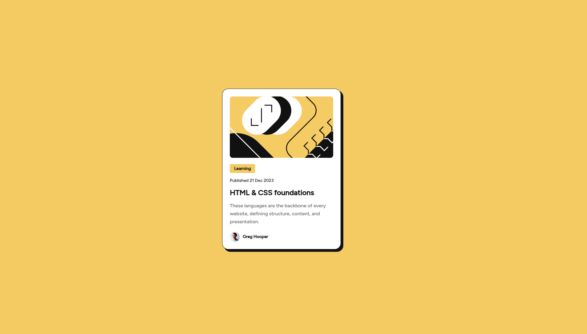

# Frontend Mentor - Blog preview card solution

This is a solution to the [Blog preview card challenge on Frontend Mentor](https://www.frontendmentor.io/challenges/blog-preview-card-ckPaj01IcS). Frontend Mentor challenges help you improve your coding skills by building realistic projects. 

## Table of contents

- [Overview](#overview)
  - [The challenge](#the-challenge)
  - [Screenshot](#screenshot)
  - [Links](#links)
- [My process](#my-process)
  - [Built with](#built-with)
  - [What I learned](#what-i-learned)
  - [Continued development](#continued-development)

## Overview

### The challenge

Users should be able to:

- See hover and focus states for all interactive elements on the page

### Screenshot

### Links

- Solution URL: [Solution](https://github.com/elhuzain/blog-preview-card)
- Live Site URL: [Live Preview](https://elhuzain.github.io/blog-preview-card)

## My process

### Built with

- Semantic HTML5 markup
- CSS custom properties
- Flexbox
- CSS Grid
- Mobile-first workflow

### What I learned

In this small project, I focused on exploring:

BEM (Block-Element-Modifier) CSS styling pattern,
for example: `article__author`.

I also practiced using conventional commits for Git commits,
for example: `docs: updated README.md`.

I learned how Flexbox can center the card both horizontally and vertically by applying alignment properties to its parent container.

### Continued development

I aim to improve my HTML and CSS accessibility skills by adding clear keyboard focus states and testing interactive elements without using a mouse.
